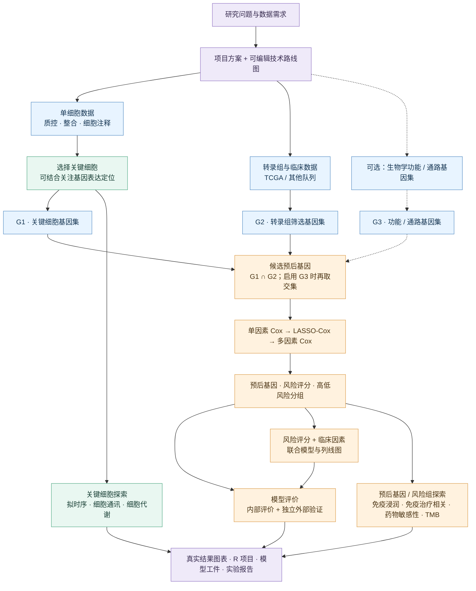

<div align="center">

# PrognosisModelPilot

**从研究构想到预后模型：让单细胞与转录组分析走成一条清晰、可追溯的研究路线。**

一个面向肿瘤预后研究的 Codex Skill，协助制定项目方案、适配 R 分析代码、生成可视化结果并撰写实验报告。

`Single-cell RNA-seq` · `Bulk RNA-seq` · `TCGA` · `Cox / LASSO` · `Visualization`

[核心工作流](#研究工作流) · [快速开始](#快速开始) · [输入与交付](#输入与交付) · [参考代码](#仓库内容) · [使用边界](#使用边界)

</div>

---

## 从一个研究问题开始

你是否希望结合**感兴趣的生物学过程、肿瘤微环境中的关键细胞和患者转录组数据**，构建有生物学依据的预后模型？

PrognosisModelPilot 将研究设计、数据处理、模型构建和报告组织成一套连贯工作流。你可以从新癌种、新队列和感兴趣的通路出发，也可以只让它撰写方案、适配代码或整理已有结果。

| 研究阶段 | Skill 可以协助完成 |
| :--- | :--- |
| **构思与方案** | 梳理科学问题、数据来源和分析模块，撰写方案并绘制技术路线图 |
| **数据与候选基因** | 结合单细胞关键细胞、bulk 转录组和可选功能通路，设计候选基因筛选路线 |
| **模型与临床应用** | 依次进行单因素 Cox、LASSO-Cox 和多因素 Cox，构建风险评分和临床列线图 |
| **生物学探索** | 围绕风险分层和关键细胞，规划并实施免疫、药敏、突变、细胞通讯等分析 |
| **交付与报告** | 组织 R 脚本、真实结果图表、模型工件和实验报告，记录输入、方法及完成状态 |

## 研究工作流

下图基于已有的研究路线整理：单细胞和转录组各自形成基因集，按需加入功能通路，再进入预后建模。虚线表示可选输入。



关键细胞的下游探索可在相关数据就绪后独立开展；流程图表达研究依赖，不代表所有模块都已运行。G3 未启用时，候选基因取 `G1 ∩ G2`。训练集与验证集的患者隔离、筛选和预处理应遵循具体研究设计，详见 [核心研究流程](prognosis-model-pilot/references/core-workflow.md)。

## 快速开始

### 1. 安装到 Codex

在 Codex 中发送以下请求，由内置的 `$skill-installer` 安装本仓库的 skill：

```text
使用 $skill-installer 安装 https://github.com/YaoRunTian/PrognosisModelPilot-skill/tree/main/prognosis-model-pilot
```

安装完成后，在后续对话中通过 `$prognosis-model-pilot` 调用。也可以在 Codex 中描述研究目标，让它判断是否使用该 skill。有关 Codex skills 的基础概念，请参阅 [OpenAI 官方说明](https://developers.openai.com/plugins/concepts/skills)。

### 2. 描述你的研究任务

例如，设计一个**糖原代谢 × 肺腺癌单细胞 × TCGA 转录组**的预后研究：

```text
$prognosis-model-pilot

我想研究糖原代谢与肺腺癌预后的关系。请整合肺腺癌单细胞数据、
TCGA-LUAD 转录组和临床数据，以及糖原代谢通路基因集，设计预后模型项目。
先撰写研究方案和可编辑流程图；再根据数据与运行条件编写和执行 R 分析，
输出结果图表、模型文件和实验报告。请提供独立外部验证方案，
并明确标记无法完成或缺少数据的分析。
```

你也可以提出局部任务，例如“仅撰写项目方案”“根据已有结果撰写报告”或“适配某个参考项目的 R 脚本”。Skill 会按本次任务范围工作。

### 3. 提供或确认输入

建议说明癌种、研究终点、单细胞和 bulk 队列、外部验证队列、感兴趣的基因或通路，以及已有数据和可用计算环境。缺少必要输入时，skill 会先推进不受影响的部分，并注明待补事项。

对于尚未取得的 TCGA 转录组和临床信息，默认采用 `TCGAbiolinks` 的 GDC 数据获取流程；已有数据时先核对并使用。详见 [TCGA 获取说明](prognosis-model-pilot/references/tcga-acquisition.md)。

## 输入与交付

完整项目根据数据、环境和实际运行情况，目标交付：

- **方案与路线**：项目方案、技术路线图及可编辑 PPTX、配套图片。
- **可复用分析项目**：适配后的 R 脚本、配置、输入输出记录、运行与续跑说明。
- **结果与可视化**：各已完成模块的结果表、独立 PNG/PDF 图片及必要的中间对象。
- **模型与评价**：模型、预处理与分组规则等工件，以及内部评价和独立外部验证的实际结果。
- **实验报告**：依据真实结果编写的可编辑 Word 和 PDF，含图表、来源索引和局限。

交付结构与图表风格参照已整理的项目方案及报告；具体文件、执行状态和缺失项以项目实际情况为准。参考 [交付约定](prognosis-model-pilot/references/output-contract.md) 和 [文档格式](prognosis-model-pilot/references/document-format.md)。

## 仓库内容

```text
prognosis-model-pilot/
├── SKILL.md                  # Skill 入口与工作规则
├── assets/                   # 方案、报告、配置与交付清单模板
├── references/               # 研究路线、分析标准与方案/报告参考
│   └── project-code/         # 5 个项目的 101 份 R/Rmd 参考脚本及索引
├── scripts/                  # TCGA 获取与交付检查脚本
└── agents/                   # Skill 元数据
```

参考项目按 `project001` 起编号。代码、输入输出依赖和适配提示见 [参考代码索引](prognosis-model-pilot/references/project-code/INDEX.md)；这些素材让新项目可以参考既有实现，而无需访问原服务器。

## 使用边界

本项目目前是基于参考项目整理的 **0.9.1 草案**。仓库提供的是工作流程、模板和参考代码，并非开箱即用的完整分析软件：

- 参考脚本已经做语法检查，但完整流程尚未在真实数据上复现；旧脚本中的已知问题需在新项目中检查和修正。
- 患者数据、完整服务器代码库、数据库缓存及部门标准原件不随包提供；运行需要匹配的数据、R 包、系统环境和足够的计算资源。
- 模型与分析结果取决于队列、方法及实际执行。应保留未完成、阴性及不稳定结果，不将方案中的预期结果写成已完成的发现。
- 本工具用于科研分析，模型性能和生物学解释需经独立验证与专业审阅，不能直接用于临床决策。

---

如果这个项目对你的研究有帮助，欢迎通过 GitHub Issues 分享使用体验、问题和改进建议。
