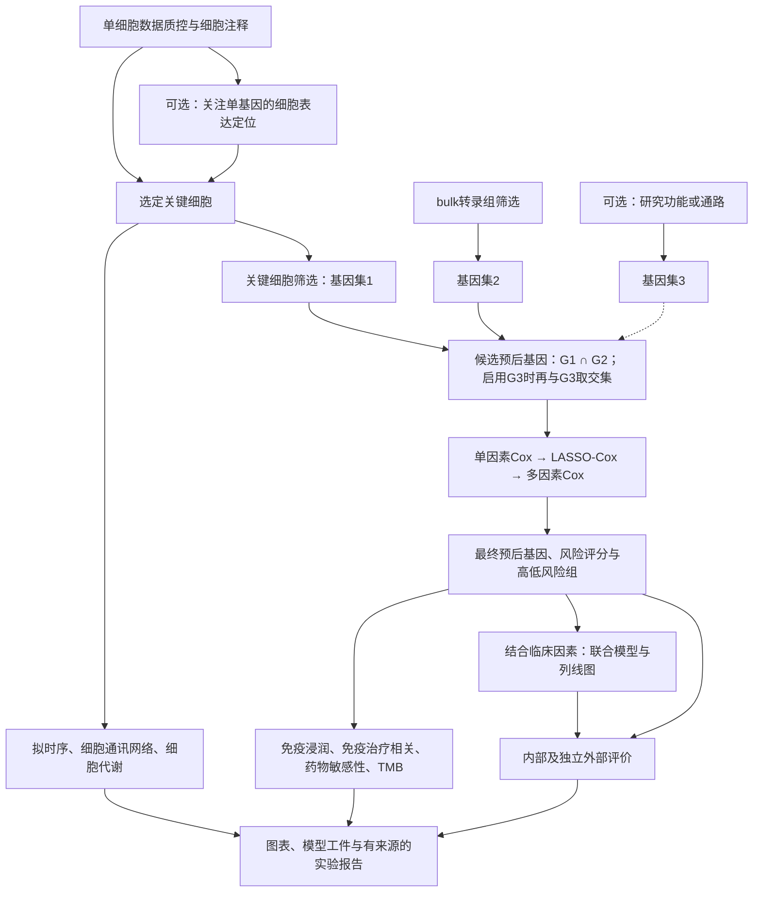

# 用户指定的核心研究流程

本路线由用户于2026-10-23明确，适用于后续新癌种、新队列的默认设计。肺腺癌是当前实例，不把LUAD、恶性上皮细胞或某个单基因固定为技能的通用研究对象。流程设计、项目代码生成和真实数据执行分别记录状态。

2026-10-24纳入的 [部门标准v5.0](department-standards-v5.md) 补充默认阈值、PH检查、细胞注释证据与交付条件。下面的生物学主线保持用户指定顺序；完整预后项目的外部验证按该标准执行，LUAD不属于内部验证可替代的例外癌种。

## 从研究切入点到三个基因集

1. **确定关键细胞**：对单细胞数据质控、整合及注释。可先查看关注单基因在各细胞类型、患者和分组中的表达及表达比例，再结合研究问题选择关键细胞；也可由已明确的关键细胞直接开始。表达定位是选择依据之一，不等于已证明因果或预后价值。保留选择依据，不默认最高表达的细胞就是关键细胞。
2. **关键基因集1（G1）**：从选定关键细胞提取基因集。根据问题选择marker、细胞状态间差异、WGCNA/hdWGCNA模块、Scissor关联细胞基因、通讯配体受体基因或已指定目标的虚拟敲除响应基因等路线；不把所有算法强制叠加。若组合模块基因和扰动响应等多个单细胞子集，分别命名并记录内部交并规则，再形成G1，不能把它们误称为外部功能通路G3。明确比较对象、患者层级、阈值及模块选择依据，避免把细胞数量当患者重复数。
3. **关键基因集2（G2）**：从bulk转录组筛选，常用肿瘤与正常或预设表型之间的差异表达；也可按已指定的网络或其他筛选规则取得。明确对比、协变量、输入尺度、基因背景、效应量及p/FDR规则。来自训练队列的数据学习步骤须进入相应训练折，不能先用训练和测试合并数据筛选后再评价。
4. **关键基因集3（G3，可选）**：使用用户想研究的生物学功能或通路集合。记录物种、数据库/文献、版本、通路标识及基因表；用户未指定主题时保持未启用，不擅自加入某个热门通路。
5. **取交集**：统一且可追溯地映射基因ID、处理重复和未映射条目后，未启用G3时取`G1 ∩ G2`；启用时取`G1 ∩ G2 ∩ G3`。保留集合原表、筛选后列表及逐基因归属表，并导出交集图和实际数量。空交集时报告在哪一步归零，不自动改并集、放宽阈值或删除已启用的G3。

独立单细胞队列和外部固定通路可以形成预先锁定的先验。若G1来自与预后队列有患者重叠的数据，或Scissor等步骤使用预后队列结局，患者隔离及相应折内重算同样适用于这些步骤；不能以“单细胞来源”豁免。

候选基因的GO/KEGG富集及PPI可作为候选解释分支；仅画PPI网络不代表进行了额外基因筛选。确实使用CytoHubba等网络筛选时，记录算法、阈值、输入输出及其在候选链中的位置。虚拟敲除也须区分上游G1来源和建模后解释用途：如16报告图置于预后基因之后，24报告图置于候选交集之前，不能相互改写。来源与其他变体见 [report-flowcharts.md](report-flowcharts.md)。

## 三阶段预后基因筛选与临床列线图

在患者级开发和评价设计确定后，按以下顺序实施，并把整条选择流程纳入内部重采样评价：

1. **单因素Cox**：对候选基因逐一拟合真实生存时间与删失事件，记录PH诊断。部门默认筛选`p<0.05`、95%CI；记录使用原始p还是多重校正p、HR和CI及预先确定的例外。PH检验不显著不是假设已被证明成立，不填入旧项目数值作为本项目结果。
2. **LASSO-Cox**：对单因素筛选后的候选进行`family="cox"`、`alpha=1`的惩罚回归。缺失处理、标准化及lambda选择均在相应训练折内拟合，导出系数路径、交叉验证结果和非零基因。
3. **多因素Cox**：以LASSO选出的基因进入多因素模型，依据明确的保留规则确定最终预后基因；检查收敛、共线性、事件信息量及PH假设。零入模、估计不稳定或不收敛时给出具体诊断，不为得到模型反复改种子或放宽条件。筛选后同一数据上的p值和CI按探索性结果解释。
4. **预后评分与分层**：从最终多因素Cox对象计算线性预测值`eta = Σ(beta_j × transformed_expression_j)`，保存最终系数与同一预处理。高低风险阈值从开发数据按预定规则确定，并在验证及下游中复用。连续分数作为性能评价输入，风险组用于预设分层与展示。
5. **临床独立性与列线图**：以预后评分结合预先选择且可取得的年龄、分期等临床因素建立联合Cox模型；默认不同时重复纳入评分和构成评分的所有基因。列线图是该联合模型的展示，保存完整模型、临床变量编码、基线生存与时间单位，以便计算指定时间的生存概率。时间点按随访支持情况预设，不机械固定为1/3/5年。
6. **评价**：分别评价基因模型、临床基线模型和联合模型的区分度、校准及适用时的临床净获益。内部和外部队列分别报告；冻结基因、转换、模型、临床编码和阈值。跨平台队列先核对测量尺度与基因覆盖，不能直接把芯片信号当TPM，也不联合拟合批次校正来掩盖可迁移性问题。

部门标准要求预后基因通常最多8个；将其作为预先设定的复杂度目标并结合事件信息量判断。未达标时记录问题，不截断已拟合系数来凑数量。临床列线图需风险评分及至少一个有依据的临床因素；只有评分时交付基因模型评价，不绘制冒称临床联合模型的列线图。ROC优先考虑1/3/5年，在队列随访支持和统一时间单位后确定，部门AUC>0.6目标与实际结果分别记录。

将“基因级多因素Cox筛选”与“风险评分结合临床变量的独立预后分析/联合Cox”分别记录输入、对象和结果；旧图只在列线图分支出现多因素Cox时，不据此认定基因筛选也做了该步骤。新项目仍遵循用户指定的三阶段基因筛选。

实现列线图时参考[rms官方手册](https://cran.r-project.org/web/packages/rms/rms.pdf)中的Cox建模、预测、nomogram及校准接口；函数与参数以实际安装版本为准。

## 两条下游分析主线

完整项目默认规划下表全部模块。生成和执行跟随用户本次任务范围；缺少输入或执行条件时记录模块状态、具体缺项及可继续部分，不静默省略，也不把计划写成结果。下游不反向用于反复挑选能使模型显著的基因。

| 对象与模块 | 实施与解释要点 |
|---|---|
| 预后基因及风险组：免疫浸润 | 在尺度符合方法要求的bulk表达上估计免疫细胞组成/分数；开展基因表达或连续评分关联及高低风险组比较，记录多重检验处理与适用协变量。浸润估计不是单细胞实测计数。 |
| 预后基因及风险组：免疫治疗相关 | 无治疗反应队列时，免疫检查点表达、TIDE/IPS等属于相关性或计算预测；有实际治疗与反应/生存记录时，冻结模型后在该队列评价。治疗队列内预后关联本身不能证明相对治疗获益。 |
| 预后基因及风险组：药物敏感性 | 记录预测工具、训练药敏资源、表达适配及药物标识；比较预测IC50/AUC或关联时写清方向和量纲，不当作临床给药建议或已完成药敏实验。 |
| 预后基因及风险组：TMB与突变 | 接入可匹配患者的突变数据和受检样本清单，固定突变类别与过滤规则；报告每Mb负荷时注明有效/采用的测序区域分母和限制。未测序或缺记录不能填零；只有突变计数时明确称计数，不能冒称mut/Mb。可分析TMB与基因表达、风险评分及风险组的关联。 |
| 关键细胞：拟时序 | 在选定细胞及合理的起始/参考状态内推断轨迹，记录根节点依据，展示预后基因或候选通路随状态的变化。拟时序不是实测时间，也不直接证明分化方向或因果。 |
| 关键细胞：细胞通讯网络 | 围绕关键细胞研究发送、接收及与其他细胞的联系，保留所需其他细胞类型；仅保留关键细胞的对象通常不能回答其与全微环境的通讯问题。记录物种/配体受体库、组间比较及供体支持。 |
| 关键细胞：细胞代谢 | 在满足所选方法输入要求的表达层上评估代谢通路活性及细胞状态差异；记录代谢基因集与版本，按患者组织比较。表达推断的活性分数不等于代谢通量实测。 |

## 默认流程图

流程图表示研究依赖，不替代患者隔离和折内筛选设计；关键细胞下游可在其输入就绪后独立开展，无需等待生存模型成功。
